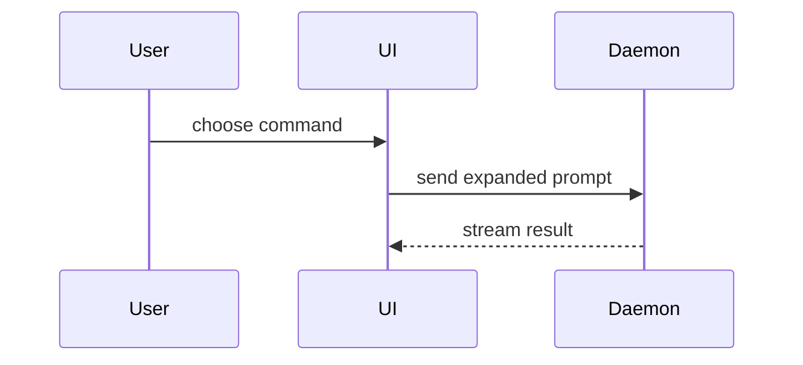

# Show me

Help the user understand the current topic, architecture, code flow, or pull request visually. Skip the preamble and keep prose brief. Visuals lead; text only labels and clarifies. Pick the smallest view that makes the key point clear.

## Visual shapes

### Logic or algorithm as pseudocode

Show logic or algorithm flow without syntax boilerplate:

```text
on(save)
  if content is unchanged
    return cached result
  write new content
  return fresh result
```

### Runtime control flow as a call tree

Show execution order, call depth, and async launches:

```text
submitForm
  createSession
    persistPrompt
    launchAgent
  navigateToSession
```

### UI structure as a component tree

Show component hierarchy, state hooks, and module boundaries that matter:

```tsx
<SessionPage> (apps/example/src/routes/session.tsx)
  useSessionEvents()
  <SessionToolbar>
    <RunSkillButton> (packages/ui)
```

### File responsibility or refactor as a shallow file tree

Show module organization, directory boundaries, and responsibilities:

```text
src/
├── commands/       # parses user actions
├── sessions/       # owns session state
└── transport/      # sends API requests
```

### Component interaction, control flow, or data flow with Mermaid

Show interactions, sequence of events, or state transitions:



### Diff shapes

Use `diff` when the point is what changes and the surrounding shape already exists. Match the diff shape to the topic.

For a component change:

```diff
 <SessionPage>
   useSessionEvents()
   <SessionToolbar>
+    <RunSkillButton />
   <SessionTimeline>
+    <SkillResultCard />
```

For a file-layout change:

```diff
 src/
 ├── commands/
+│   └── show-me.ts       # expands the slash command
 ├── sessions/
-└── transport.ts
+└── transport/
+    ├── client.ts
+    └── stream.ts
```

For a call-tree or call-stack change:

```diff
 submitForm
   createSession
     persistPrompt
+    expandSkillMention
     launchAgent
-  navigateToSession
+  navigateToSession
+    subscribeToEvents
```

For a state or control-flow change:

```diff
 on(save)
-  write content
+  if content is unchanged
+    return cached result
+  write new content
+  invalidate cache
```

### Target shape or whole block

Show the whole block when most of it is new, when omitted context would hide ownership or order, or when the user needs a copyable target shape:

```ts
function expandSkill(command: string): string {
	const skillName = command.slice(1);
	return `use the ${skillName} skill`;
}
```

## Pull requests and code reviews

Invoke this skill autonomously when preparing or updating a pull request description:

- In PR descriptions (under `## Changes` or `## Summary`), replace dense paragraphs of text with focused visuals:
    - **Call-tree diffs** for changes to execution flow, hooks, or event handling.
    - **Component tree diffs** for UI structure and layout alterations.
    - **Shallow file-tree diffs** for directory reorganization, module splits, or refactors.
    - **Mermaid sequence or state diagrams** for protocol changes, API exchanges, or state transitions.
- Keep PR visuals compact: show only the affected pathways and minimal surrounding context for reviewer orientation.

## Standalone HTML artifacts (pepi-visualize)

When a visual UI, layout, state comparison, or concept is too dense, complex, or interactive for Mermaid or inline Markdown:

- Trigger the **`pepi-visualize`** skill.
- `pepi-visualize` creates a self-contained, single-file HTML visualization in the One Dark theme with VS Code Dark+ code blocks (including interactive steppers, SVG architecture maps, or side-by-side panels) at `.scratch/visualize/<slug>.html` and opens it in the browser.

## Guidance

- Place each visual next to the short text it supports.
- Skip conversational preambles ("Here is a diagram showing...", "Let me explain...").
- Keep only the calls, files, props, states, and boundaries needed to answer the user's question or make the PR obvious.
- Pick the smallest fitting tool; do not overwhelm the user or reviewer with multiple redundant diagrams.
